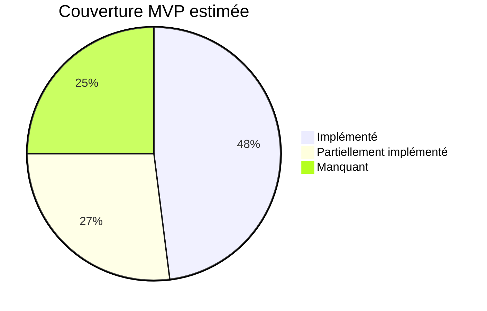

# 🔍 Analyse MVP — AZ PULSE vs Architecture Fonctionnelle

> [!NOTE]
> Cette analyse compare l'état **réel du code** au périmètre MVP défini dans le document d'architecture (§16). Chaque bloc P0/P1 est évalué sur trois axes : **Backend (API/métier)**, **Frontend (UI)**, et **Interconnexion (flux/événements)**.

---

## Vue d'ensemble

| Bloc MVP | Priorité | Couverture | Verdict |
|----------|----------|------------|---------|
| IAM / Accès | P0 | 🟢 ~85% | Solide, quelques lacunes |
| CRM | P0 | 🟢 ~75% | Cœur présent, UI partielle côté collaborateur |
| Workspace | P0 | 🟡 ~50% | Backend OK, frontend = placeholder |
| Formation | P0 | 🟡 ~55% | Espace apprenant riche, cœur gestion manquant |
| Knowledge Hub | P0 | 🟡 ~40% | API base présente, frontend = placeholder |
| Infrastructure & IT | P0 | 🟢 ~70% | GLPI intégré, UI livrée |
| Dashboard | P0 | 🟢 ~75% | Multi-rôle, API consolidée |
| Analytics | P1 | 🔴 ~10% | Quasi absent |
| AI Workspace | P1 | 🟡 ~45% | Pipeline Symfony→FastAPI fonctionnel, UI = placeholder |
| n8n | P1 | 🟡 ~30% | Container prêt, aucun workflow livré |
| Temps réel (Mercure) | P1 | 🔴 ~0% | Non implémenté |

---

## Détail par bloc P0

### 1. IAM / Accès — 🟢 ~85%

**✅ Ce qui est en place :**
- Authentification complète ([AuthController.php](file:///h:/PROJETS/VS_Projects/L3_LICENCE_ING/AZ_PULSE/Backend/src/Controller/AuthController.php), [AuthService.php](file:///h:/PROJETS/VS_Projects/L3_LICENCE_ING/AZ_PULSE/Backend/src/Service/AuthService.php))
- Demande d'accès avec workflow PENDING → APPROVED / REJECTED ([AccessRequestService.php](file:///h:/PROJETS/VS_Projects/L3_LICENCE_ING/AZ_PULSE/Backend/src/Service/AccessRequestService.php))
- Activation du compte après approbation ([ActivateAccount.jsx](file:///h:/PROJETS/VS_Projects/L3_LICENCE_ING/AZ_PULSE/frontend/src/pages/ActivateAccount.jsx))
- Pages de suivi de statut : [PendingAccess.jsx](file:///h:/PROJETS/VS_Projects/L3_LICENCE_ING/AZ_PULSE/frontend/src/pages/PendingAccess.jsx), [RejectedAccess.jsx](file:///h:/PROJETS/VS_Projects/L3_LICENCE_ING/AZ_PULSE/frontend/src/pages/RejectedAccess.jsx)
- Modèle RBAC complet : entités `Role`, `Permission`, `UserPermissionOverride`
- Voters Symfony : [PermissionVoter.php](file:///h:/PROJETS/VS_Projects/L3_LICENCE_ING/AZ_PULSE/Backend/src/Security/Voter/PermissionVoter.php), [ProjectVoter.php](file:///h:/PROJETS/VS_Projects/L3_LICENCE_ING/AZ_PULSE/Backend/src/Security/Voter/ProjectVoter.php)
- Routing par rôle : [RoleRedirect](file:///h:/PROJETS/VS_Projects/L3_LICENCE_ING/AZ_PULSE/frontend/src/components/guards/RoleRedirect.jsx), [ProtectedRoute](file:///h:/PROJETS/VS_Projects/L3_LICENCE_ING/AZ_PULSE/frontend/src/components/guards/ProtectedRoute.jsx)
- Journal d'audit : [AuditLog.php](file:///h:/PROJETS/VS_Projects/L3_LICENCE_ING/AZ_PULSE/Backend/src/Entity/AuditLog.php), [AuditSubscriber.php](file:///h:/PROJETS/VS_Projects/L3_LICENCE_ING/AZ_PULSE/Backend/src/EventSubscriber/AuditSubscriber.php), [AuditLog.jsx](file:///h:/PROJETS/VS_Projects/L3_LICENCE_ING/AZ_PULSE/frontend/src/pages/AuditLog.jsx)
- Gestion des demandes d'accès côté admin : [AdminRequests.jsx](file:///h:/PROJETS/VS_Projects/L3_LICENCE_ING/AZ_PULSE/frontend/src/pages/AdminRequests.jsx)
- Reset password : [ForgotPassword.jsx](file:///h:/PROJETS/VS_Projects/L3_LICENCE_ING/AZ_PULSE/frontend/src/pages/ForgotPassword.jsx), [ResetPassword.jsx](file:///h:/PROJETS/VS_Projects/L3_LICENCE_ING/AZ_PULSE/frontend/src/pages/ResetPassword.jsx)

**❌ Ce qui manque :**
- **Admin ≠ Super Admin sur la gestion des utilisateurs** : le §5.2 dit que l'Admin/Direction gère les utilisateurs de son périmètre sans administrer les autres admins. La route `/superadmin/users` pointe vers `SuperAdminDashboard` — pas de vue dédiée pour que l'Admin gère ses propres utilisateurs.
- **Statut MORE_INFO_REQUIRED / CANCELLED** : le §5.1 les mentionne, mais non vérifié dans le code de la state machine des demandes d'accès.
- **Interface d'administration des rôles et permissions** : pas d'écran permettant au Super Admin de créer/modifier les rôles et permissions dynamiquement (UI).

---

### 2. CRM — 🟢 ~75%

**✅ Ce qui est en place :**
- Entités : [Customer.php](file:///h:/PROJETS/VS_Projects/L3_LICENCE_ING/AZ_PULSE/Backend/src/Entity/Customer.php), [Opportunity.php](file:///h:/PROJETS/VS_Projects/L3_LICENCE_ING/AZ_PULSE/Backend/src/Entity/Opportunity.php), [Activity.php](file:///h:/PROJETS/VS_Projects/L3_LICENCE_ING/AZ_PULSE/Backend/src/Entity/Activity.php), [Reminder.php](file:///h:/PROJETS/VS_Projects/L3_LICENCE_ING/AZ_PULSE/Backend/src/Entity/Reminder.php)
- Controllers : [CrmCustomerController.php](file:///h:/PROJETS/VS_Projects/L3_LICENCE_ING/AZ_PULSE/Backend/src/Controller/CrmCustomerController.php), [CrmOpportunityController.php](file:///h:/PROJETS/VS_Projects/L3_LICENCE_ING/AZ_PULSE/Backend/src/Controller/CrmOpportunityController.php), [CrmPipelineController.php](file:///h:/PROJETS/VS_Projects/L3_LICENCE_ING/AZ_PULSE/Backend/src/Controller/CrmPipelineController.php), [CrmReminderController.php](file:///h:/PROJETS/VS_Projects/L3_LICENCE_ING/AZ_PULSE/Backend/src/Controller/CrmReminderController.php), [CrmActivityController.php](file:///h:/PROJETS/VS_Projects/L3_LICENCE_ING/AZ_PULSE/Backend/src/Controller/CrmActivityController.php)
- Frontend : [CrmPipeline.jsx](file:///h:/PROJETS/VS_Projects/L3_LICENCE_ING/AZ_PULSE/frontend/src/features/collaborateur/pages/CrmPipeline.jsx), [CrmCustomers.jsx](file:///h:/PROJETS/VS_Projects/L3_LICENCE_ING/AZ_PULSE/frontend/src/features/collaborateur/pages/CrmCustomers.jsx), [CrmReminders.jsx](file:///h:/PROJETS/VS_Projects/L3_LICENCE_ING/AZ_PULSE/frontend/src/features/collaborateur/pages/CrmReminders.jsx)
- Composants UI riches : [OpportunityCard.jsx](file:///h:/PROJETS/VS_Projects/L3_LICENCE_ING/AZ_PULSE/frontend/src/features/collaborateur/components/crm/OpportunityCard.jsx), [OpportunityForm.jsx](file:///h:/PROJETS/VS_Projects/L3_LICENCE_ING/AZ_PULSE/frontend/src/features/collaborateur/components/crm/OpportunityForm.jsx), [PipelineBoard.jsx](file:///h:/PROJETS/VS_Projects/L3_LICENCE_ING/AZ_PULSE/frontend/src/features/collaborateur/components/crm/PipelineBoard.jsx)
- Événements métier : `OpportunityStageChangedEvent`, `OpportunityWonEvent`
- [ProjectCreationSubscriber.php](file:///h:/PROJETS/VS_Projects/L3_LICENCE_ING/AZ_PULSE/Backend/src/EventSubscriber/ProjectCreationSubscriber.php) — création automatique de projet sur opportunité gagnée (flux §11.1)

**❌ Ce qui manque :**
- **Transition PROSPECT → CLIENT** (§15.3) : pas d'état-transition explicite visible. L'entité `Customer` existe mais la distinction prospect/client et le passage d'un état à l'autre n'est pas clairement formalisé.
- **Historique commercial** par client : pas de vue consolidée de l'historique complet (opportunités + activités + projets liés).
- **KPI CRM sur le Dashboard CRM** : l'API `/api/dashboard/crm` renvoie des stats basiques mais le frontend ne les consomme pas dans un Dashboard CRM dédié (le module CRM côté collaborateur n'a pas d'onglet dashboard).

---

### 3. Workspace — 🟡 ~50%

**✅ Ce qui est en place :**
- Entités : [Project.php](file:///h:/PROJETS/VS_Projects/L3_LICENCE_ING/AZ_PULSE/Backend/src/Entity/Project.php) (complet : name, description, status, priority, progress, budget, dates, customer, manager, members, tasks), [Task.php](file:///h:/PROJETS/VS_Projects/L3_LICENCE_ING/AZ_PULSE/Backend/src/Entity/Task.php), [Milestone.php](file:///h:/PROJETS/VS_Projects/L3_LICENCE_ING/AZ_PULSE/Backend/src/Entity/Milestone.php), [Deliverable.php](file:///h:/PROJETS/VS_Projects/L3_LICENCE_ING/AZ_PULSE/Backend/src/Entity/Deliverable.php), [Assignment.php](file:///h:/PROJETS/VS_Projects/L3_LICENCE_ING/AZ_PULSE/Backend/src/Entity/Assignment.php)
- Controllers : [WorkspaceProjectController.php](file:///h:/PROJETS/VS_Projects/L3_LICENCE_ING/AZ_PULSE/Backend/src/Controller/WorkspaceProjectController.php) (CRUD complet avec RBAC), [WorkspaceTaskController.php](file:///h:/PROJETS/VS_Projects/L3_LICENCE_ING/AZ_PULSE/Backend/src/Controller/WorkspaceTaskController.php)
- Événements : `ProjectCreatedEvent`, `TaskCompletedEvent`
- Analyse IA de projet : [ProjectAiController.php](file:///h:/PROJETS/VS_Projects/L3_LICENCE_ING/AZ_PULSE/Backend/src/Controller/ProjectAiController.php) + [ProjectContextBuilder.php](file:///h:/PROJETS/VS_Projects/L3_LICENCE_ING/AZ_PULSE/Backend/src/Service/AI/ProjectContextBuilder.php) + [AIService.php](file:///h:/PROJETS/VS_Projects/L3_LICENCE_ING/AZ_PULSE/Backend/src/Service/AI/AIService.php)

**❌ Ce qui manque :**
- **Frontend Workspace** : la route `/collaborateur/projets` est un **placeholder** (« Workspace — En construction »). **Aucune UI pour les projets, les tâches, les jalons ou les livrables n'est livrée côté React.**
- **Dépendances inter-tâches** : l'architecture demande des dépendances entre tâches — non visible dans les entités actuelles.
- **Association de documents** : le lien Project ↔ Document n'est pas formalisé (pas de relation ORM entre les deux).
- **Commentaires** sur projets/tâches : mentionnés dans l'architecture, absents du modèle.

> [!WARNING]
> **C'est le plus gros trou du MVP P0.** Le backend est solide mais sans frontend, le Workspace n'est pas utilisable.

---

### 4. Formation — 🟡 ~55%

**✅ Ce qui est en place :**
- Entités : [Course.php](file:///h:/PROJETS/VS_Projects/L3_LICENCE_ING/AZ_PULSE/Backend/src/Entity/Course.php), [CourseSession.php](file:///h:/PROJETS/VS_Projects/L3_LICENCE_ING/AZ_PULSE/Backend/src/Entity/CourseSession.php), [Enrollment.php](file:///h:/PROJETS/VS_Projects/L3_LICENCE_ING/AZ_PULSE/Backend/src/Entity/Enrollment.php), [Grade.php](file:///h:/PROJETS/VS_Projects/L3_LICENCE_ING/AZ_PULSE/Backend/src/Entity/Grade.php), [Tuition.php](file:///h:/PROJETS/VS_Projects/L3_LICENCE_ING/AZ_PULSE/Backend/src/Entity/Tuition.php), [PaymentReceipt.php](file:///h:/PROJETS/VS_Projects/L3_LICENCE_ING/AZ_PULSE/Backend/src/Entity/PaymentReceipt.php), [CourseDocument.php](file:///h:/PROJETS/VS_Projects/L3_LICENCE_ING/AZ_PULSE/Backend/src/Entity/CourseDocument.php), [StudentSubmission.php](file:///h:/PROJETS/VS_Projects/L3_LICENCE_ING/AZ_PULSE/Backend/src/Entity/StudentSubmission.php), [Program.php](file:///h:/PROJETS/VS_Projects/L3_LICENCE_ING/AZ_PULSE/Backend/src/Entity/Program.php), [Promotion.php](file:///h:/PROJETS/VS_Projects/L3_LICENCE_ING/AZ_PULSE/Backend/src/Entity/Promotion.php)
- Espace Apprenant complet : [ApprenantDashboard.jsx](file:///h:/PROJETS/VS_Projects/L3_LICENCE_ING/AZ_PULSE/frontend/src/features/formation/pages/ApprenantDashboard.jsx), [ApprenantPlanning.jsx](file:///h:/PROJETS/VS_Projects/L3_LICENCE_ING/AZ_PULSE/frontend/src/features/formation/pages/ApprenantPlanning.jsx), [ApprenantEvaluations.jsx](file:///h:/PROJETS/VS_Projects/L3_LICENCE_ING/AZ_PULSE/frontend/src/features/formation/pages/ApprenantEvaluations.jsx), [ApprenantPaiements.jsx](file:///h:/PROJETS/VS_Projects/L3_LICENCE_ING/AZ_PULSE/frontend/src/features/formation/pages/ApprenantPaiements.jsx), [ApprenantFormations.jsx](file:///h:/PROJETS/VS_Projects/L3_LICENCE_ING/AZ_PULSE/frontend/src/features/formation/pages/ApprenantFormations.jsx), [ApprenantDocuments.jsx](file:///h:/PROJETS/VS_Projects/L3_LICENCE_ING/AZ_PULSE/frontend/src/features/formation/pages/ApprenantDocuments.jsx)
- Espace Parent : [ParentDashboard.jsx](file:///h:/PROJETS/VS_Projects/L3_LICENCE_ING/AZ_PULSE/frontend/src/pages/ParentDashboard.jsx) + [ParentDashboardController.php](file:///h:/PROJETS/VS_Projects/L3_LICENCE_ING/AZ_PULSE/Backend/src/Controller/ParentDashboardController.php)
- Événements : `EnrollmentCreatedEvent`, `GradePublishedEvent`, `TuitionPaymentReceivedEvent`
- Backend Formation : [ApprenantDashboardController.php](file:///h:/PROJETS/VS_Projects/L3_LICENCE_ING/AZ_PULSE/Backend/src/Controller/ApprenantDashboardController.php), [AcademyController.php](file:///h:/PROJETS/VS_Projects/L3_LICENCE_ING/AZ_PULSE/Backend/src/Controller/AcademyController.php)

**❌ Ce qui manque :**
- **Espace Formateur/Intervenant** : le §4 définit un profil `Formateur / Intervenant` avec sessions, apprenants suivis et évaluations — **aucune route ni interface formateur n'existe**.
- **Interface de gestion Formation côté responsable** : la route `/collaborateur/formations` est un placeholder. Le Responsable Formation n'a pas d'écran pour gérer les formations, sessions, inscriptions et notes.
- **Workflow paiement par justificatif** (§7.2) : le modèle de données (Tuition, PaymentReceipt) existe mais **le workflow complet OCR → vérification → validation → reçu AZ PULSE n'est pas implémenté**. Pas de route FastAPI OCR, pas d'interface de dépôt de justificatif.
- **Dashboard Apprenant** : l'API `/api/dashboard/apprenant` renvoie des données en dur (hardcodées), pas des données réelles.

---

### 5. Knowledge Hub — 🟡 ~40%

**✅ Ce qui est en place :**
- Entités : [Document.php](file:///h:/PROJETS/VS_Projects/L3_LICENCE_ING/AZ_PULSE/Backend/src/Entity/Document.php), [Folder.php](file:///h:/PROJETS/VS_Projects/L3_LICENCE_ING/AZ_PULSE/Backend/src/Entity/Folder.php), [Category.php](file:///h:/PROJETS/VS_Projects/L3_LICENCE_ING/AZ_PULSE/Backend/src/Entity/Category.php), [Tag.php](file:///h:/PROJETS/VS_Projects/L3_LICENCE_ING/AZ_PULSE/Backend/src/Entity/Tag.php), [DocumentVersion.php](file:///h:/PROJETS/VS_Projects/L3_LICENCE_ING/AZ_PULSE/Backend/src/Entity/DocumentVersion.php), [DocumentFavorite.php](file:///h:/PROJETS/VS_Projects/L3_LICENCE_ING/AZ_PULSE/Backend/src/Entity/DocumentFavorite.php)
- Controller : [KnowledgeHubController.php](file:///h:/PROJETS/VS_Projects/L3_LICENCE_ING/AZ_PULSE/Backend/src/Controller/KnowledgeHubController.php) — liste, upload et download
- Permissions : filtre `PUBLISHED` vs `knowledge.read_all`
- Événement : `DocumentPublishedEvent`

**❌ Ce qui manque :**
- **Frontend Knowledge Hub** : la route `/collaborateur/documents` est un **placeholder**. Aucune interface de gestion documentaire côté React.
- **Gestion des versions** : l'entité `DocumentVersion` existe mais aucune API de versionning n'est implémentée.
- **Publication** : pas d'endpoint pour changer le statut d'un document (DRAFT → PUBLISHED).
- **Recherche** : pas de moteur de recherche documentaire (même basique).
- **DocumentVoter** : le download a un TODO explicite (ligne 139 de `KnowledgeHubController.php`).

---

### 6. Infrastructure & IT — 🟢 ~70%

**✅ Ce qui est en place :**
- Intégration GLPI respectant l'architecture : [GlpiService.php](file:///h:/PROJETS/VS_Projects/L3_LICENCE_ING/AZ_PULSE/Backend/src/Service/GlpiService.php) — init/kill session, récupération des ordinateurs avec `expand_dropdowns`
- Controller : [ItInfrastructureController.php](file:///h:/PROJETS/VS_Projects/L3_LICENCE_ING/AZ_PULSE/Backend/src/Controller/ItInfrastructureController.php) — endpoint sécurisé avec `#[IsGranted('it.read')]`
- Frontend : [InfrastructureManager.jsx](file:///h:/PROJETS/VS_Projects/L3_LICENCE_ING/AZ_PULSE/frontend/src/features/collaborateur/pages/InfrastructureManager.jsx) — **livré et fonctionnel** (36 Ko, UI riche)
- Entités locales : [Equipment.php](file:///h:/PROJETS/VS_Projects/L3_LICENCE_ING/AZ_PULSE/Backend/src/Entity/Equipment.php), [Incident.php](file:///h:/PROJETS/VS_Projects/L3_LICENCE_ING/AZ_PULSE/Backend/src/Entity/Incident.php)
- Événements : `IncidentOpenedEvent`, `IncidentResolvedEvent`
- Dashboard IT : l'API `/api/dashboard/it` expose les stats avec source GLPI identifiée

**❌ Ce qui manque :**
- **Maintenance** : pas d'entité ni d'API pour la maintenance planifiée (§8).
- **Licences, garanties et contrats** : mentionnés dans l'architecture, absents du modèle.
- **Types d'équipements au-delà des ordinateurs** : `getComputers()` ne couvre que les ordinateurs. Le §8.1 parle de « parc informatique » plus large.
- **Panneau de détail latéral** (§8.2) : non vérifié sans lancer l'app, mais le fichier `InfrastructureManager.jsx` est suffisamment volumineux pour peut-être l'inclure.

---

### 7. Dashboard — 🟢 ~75%

**✅ Ce qui est en place :**
- Dashboards multi-rôle : [SuperAdminDashboard.jsx](file:///h:/PROJETS/VS_Projects/L3_LICENCE_ING/AZ_PULSE/frontend/src/pages/SuperAdminDashboard.jsx) (57 Ko!), [AdminDashboard.jsx](file:///h:/PROJETS/VS_Projects/L3_LICENCE_ING/AZ_PULSE/frontend/src/pages/AdminDashboard.jsx), [ApprenantDashboard.jsx](file:///h:/PROJETS/VS_Projects/L3_LICENCE_ING/AZ_PULSE/frontend/src/features/formation/pages/ApprenantDashboard.jsx), [ParentDashboard.jsx](file:///h:/PROJETS/VS_Projects/L3_LICENCE_ING/AZ_PULSE/frontend/src/pages/ParentDashboard.jsx), [CollaborateurHome.jsx](file:///h:/PROJETS/VS_Projects/L3_LICENCE_ING/AZ_PULSE/frontend/src/features/collaborateur/pages/CollaborateurHome.jsx)
- API Dashboard agrégée : [DashboardController.php](file:///h:/PROJETS/VS_Projects/L3_LICENCE_ING/AZ_PULSE/Backend/src/Controller/DashboardController.php) — stats super-admin, admin, workspace, CRM, IT, apprenant, parent
- Notifications : [NotificationController.php](file:///h:/PROJETS/VS_Projects/L3_LICENCE_ING/AZ_PULSE/Backend/src/Controller/NotificationController.php), [NotificationSubscriber.php](file:///h:/PROJETS/VS_Projects/L3_LICENCE_ING/AZ_PULSE/Backend/src/EventSubscriber/NotificationSubscriber.php)

**❌ Ce qui manque :**
- **Insights IA** sur le dashboard : mentionnés au §6, pas implémentés.
- **Alertes contextuelles** : les notifications existent en base mais pas de panneau d'alertes intégré au dashboard.
- **Stats Formation/Apprenant/Parent** : données hardcodées (pas connectées aux vrais référentiels).

---

## Détail par bloc P1

### 8. Analytics — 🔴 ~10%

**Quasi inexistant.** Pas de module Analytics. Les seules « analytics » sont les compteurs dans le `DashboardController`. Il manque :
- Aucune UI Analytics (placeholder uniquement)
- Pas de modèle de KPI
- Pas de rapports
- Pas de tendances temporelles
- Pas de restitution de performance commerciale/projet

---

### 9. AI Workspace — 🟡 ~45%

**✅ Ce qui est en place :**
- Service FastAPI opérationnel : [main.py](file:///h:/PROJETS/VS_Projects/L3_LICENCE_ING/AZ_PULSE/Ai_Service/app/main.py) avec 4 routers (chat, analysis, projects, documents)
- 4 agents : [project_agent.py](file:///h:/PROJETS/VS_Projects/L3_LICENCE_ING/AZ_PULSE/Ai_Service/app/agents/project_agent.py), `analytics_agent.py`, `document_agent.py`, `strategic_agent.py`
- Pipeline sécurisé : React → Symfony → FastAPI → LLM (§9 respecté)
- `ProjectContextBuilder` côté Symfony pour limiter le contexte autorisé
- Événement `AiRecommendationProposedEvent` avec notification « à valider »

**❌ Ce qui manque :**
- **Frontend AI Workspace** : la route `/collaborateur/ia` est un **placeholder**. Pas d'interface de chat, de synthèse, ni d'affichage de recommandations.
- **OCR / extraction de justificatif** : mentionné au §7.2 et §9.1, non implémenté côté FastAPI.
- **Scoring et détection de risque** : mentionnés au §9.1, les agents les esquissent mais pas de workflow complet.

---

### 10. n8n — 🟡 ~30%

**✅ Ce qui est en place :**
- Container Docker n8n configuré et fonctionnel dans [docker-compose.yml](file:///h:/PROJETS/VS_Projects/L3_LICENCE_ING/AZ_PULSE/Docker/docker-compose.yml) (PostgreSQL, encryption key, etc.)
- Événements métier déclarés côté Symfony (16 événements) qui pourraient alimenter des webhooks n8n.

**❌ Ce qui manque :**
- **Aucun workflow n8n livré** : le §10 et §16 demandent 3 à 5 automatisations. Aucune n'est exportée ou documentée.
- **Pas de webhook Symfony → n8n** : les événements ne déclenchent que des notifications Symfony internes, pas de call vers n8n.

---

### 11. Temps réel (Mercure) — 🔴 0%

Aucune trace de Mercure dans le projet. Pas de container Docker, pas de bundle Symfony, pas d'EventSource côté React.

---

## Flux intermodules (§11)

| Flux | État |
|------|------|
| CRM → Workspace (opportunité gagnée → projet) | ✅ `ProjectCreationSubscriber` |
| Projet → Dashboard | ✅ Partiel (stats agrégées) |
| Projet → Analytics → IA | ❌ Analytics inexistant |
| Document → classement → publication → recherche → IA | 🟡 Upload OK, publication et recherche manquants |
| GLPI → Infrastructure → Dashboard | ✅ Fonctionnel |
| Événements métier → notifications | ✅ 16 événements avec `NotificationSubscriber` |
| Événements → n8n | ❌ Pas de webhook |

---

## Scénario transversal MVP (§16.1)

> Prospect → Opportunité → WON → Projet → Tâches → Document → Équipement → KPI → Analyse IA → notification n8n

| Étape | État |
|-------|------|
| Prospect → Opportunité | ✅ CRM fonctionnel |
| Opportunité WON → Projet | ✅ `ProjectCreationSubscriber` |
| Projet → Tâches | ✅ Backend OK, ❌ Frontend manquant |
| Tâches → Document | ❌ Pas de lien Project ↔ Document |
| Document → Équipement | ❌ Pas de lien |
| KPI | ❌ Analytics absent |
| Analyse IA | 🟡 Pipeline fonctionnel, UI manquante |
| Notification n8n | ❌ Aucun workflow n8n |

> [!IMPORTANT]
> **Le scénario transversal de démonstration ne peut PAS être déroulé de bout en bout** dans l'état actuel. Les ruptures principales sont : l'absence de frontend Workspace, l'absence du module Analytics et l'absence de workflows n8n.

---

## Portail Client (§4)

> [!CAUTION]
> Le rôle `Client` avec « portail dédié aux projets, livrables, documents, échanges et demandes » est **totalement absent**. Aucune route, aucun layout, aucun controller dédié. Ce n'est pas dans le §16 MVP explicitement mais il est listé en P0 implicitement car le CRM et Workspace sont P0.

---

## Synthèse des lacunes critiques à combler pour le MVP

### 🔴 Bloquants (sans lesquels le MVP ne peut pas être démontré)

| # | Lacune | Impact |
|---|--------|--------|
| 1 | **Frontend Workspace** (projets, tâches, jalons, livrables) | Le module P0 le plus utilisé n'a pas d'interface |
| 2 | **Frontend Knowledge Hub** (documents, recherche, publication) | Module P0 inutilisable sans UI |
| 3 | **Interface de gestion Formation** (côté responsable/formateur) | Seul l'espace apprenant/parent fonctionne ; l'administration de la formation est aveugle |
| 4 | **Module Analytics** (même basique : KPI + tendances) | P1 mais nécessaire au scénario transversal |
| 5 | **Stats Dashboard réelles** pour Apprenant/Parent | Données hardcodées → le dashboard ment |

### 🟡 Importants (améliorations nécessaires au MVP)

| # | Lacune | Impact |
|---|--------|--------|
| 6 | Frontend AI Workspace (chat, recommandations) | Le pipeline backend→FastAPI est prêt mais invisible côté utilisateur |
| 7 | 3-5 workflows n8n + webhook Symfony→n8n | L'automatisation est promise mais pas livrée |
| 8 | Workflow OCR paiement (§7.2) | Le cas d'utilisation structurant n°5 n'est pas fonctionnel |
| 9 | Transition PROSPECT → CLIENT formalisée | La continuité commerciale du §15.3 n'est pas traçable |
| 10 | Versionning documentaire (API) | L'entité existe mais pas d'endpoint |
| 11 | DocumentVoter (TODO dans le code) | Faille de sécurité : le téléchargement n'est pas contrôlé |
| 12 | Gestion dynamique des rôles/permissions (UI Super Admin) | Seule la base existe, pas l'interface |

### 🟢 Optionnel/différable

| # | Lacune | Impact |
|---|--------|--------|
| 13 | Mercure (temps réel) | Listé P1 « lorsque nécessaire » |
| 14 | Portail Client | Important mais peut venir après le noyau interne |
| 15 | Maintenance planifiée, licences, garanties | Extension naturelle du module IT |
| 16 | Espace Formateur dédié | Peut être un sous-ensemble du Responsable Formation au début |

---

## Conclusion

Le projet AZ PULSE a des **fondations solides** :
- L'architecture technique est saine (Symfony/React/FastAPI/Docker/PostgreSQL/n8n)
- Le modèle de données couvre la majorité des entités
- Le système d'événements et de notifications est remarquablement bien construit (16 événements, audit, notifications ciblées)
- L'IAM est le module le plus complet
- Le CRM et l'Infrastructure IT sont fonctionnels

**Mais le MVP n'est PAS atteint.** La couverture globale est estimée à **~50%**. Les deux lacunes les plus critiques sont :
1. **L'absence totale de frontend pour Workspace et Knowledge Hub** (les deux modules P0 les plus volumineux)
2. **L'absence du module Analytics** qui empêche le scénario transversal de démonstration

Le projet est à mi-chemin : le "squelette" (données, événements, API) est posé ; il manque les "muscles" (interfaces utilisateurs opérationnelles) et les "organes" (analytics, IA visible, automatisations).
